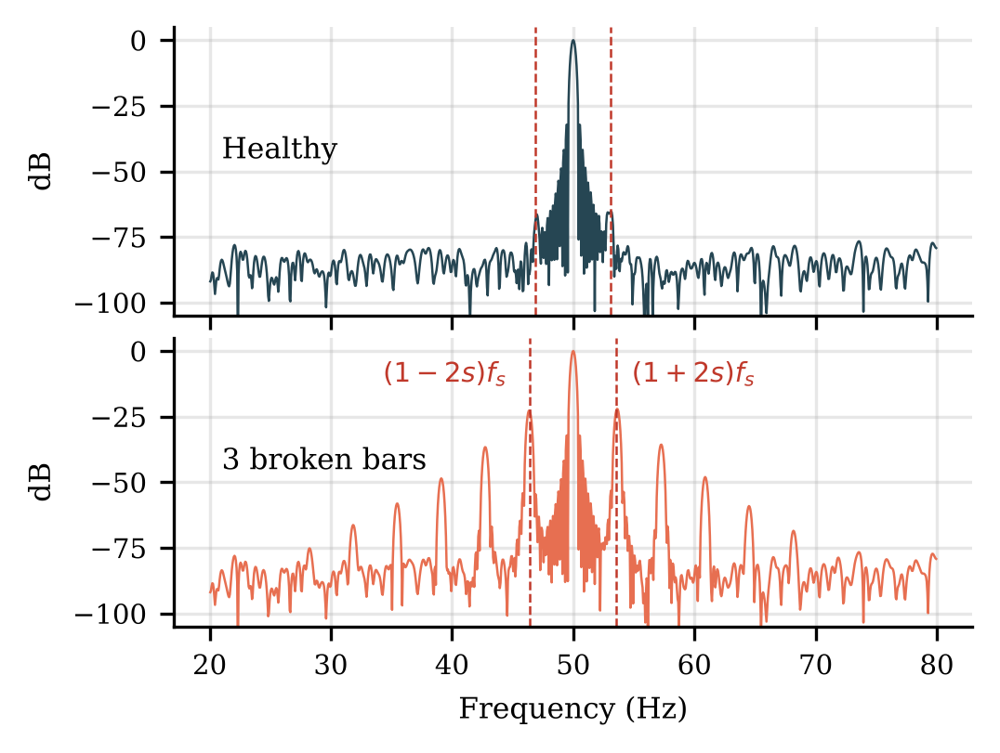

# ANN in Fault Detection & Diagnosis of Induction Motors

**Authors:** Mhamad Naser Dine · Ali Srour
**Supervisor:** Prof. Hadi Y. Kanaan
Course project – *Artificial Intelligence Based Control Systems* (Part II – Neural Networks), Saint Joseph University of Beirut (USJ – ESIB).

| Deliverable | File |
|---|---|
| IEEE-format report (6 pages) | [`IEEE_report/IEEE_Report_Motor_Fault_ANN.pdf`](IEEE_report/IEEE_Report_Motor_Fault_ANN.pdf) |
| Presentation (PowerPoint, Morph) | [`docs/The Mystery Motor – Presentation.pptx`](docs/) |
| Speaker script | [`docs/Speaker Script – The Mystery Motor.pdf`](docs/) |
| Fault-growth animation (10 s) | [`docs/Fault growth animation (10 s).mp4`](docs/) |



A complete Python simulation + neural-network pipeline:

```
 dq motor model ──► fault injection ──► noisy currents/voltages ──► MCSA features ──► ANN ──► Healthy ✅ / fault ⚠️
 (scipy ODE)        (BRB, ITSC,          (sensor model)              (19 features)     (from-scratch NumPy:
                     bearing, unbalance)                                                 Perceptron, ADALINE, MLP-BP,
                                                                                         momentum, adaptive η, LM, RBF)
```

## 1. Install & run

```bash
pip install -r requirements.txt
python train.py          # trains everything, saves models/, figures/, results/ (≈ 2 min with the provided dataset)
python experiments.py    # reliability studies: noise/load/severity, 10 repeated runs, hidden neurons (≈ 9 min)
streamlit run app.py     # opens the GUI in the browser
```

`data/dataset.csv` (1500 simulated motors) is included. To regenerate it: `python train.py --regen --n 300`
(≈ 10 min on 2 cores, uses all CPU cores) or use page 2 of the app.

## 2. Project structure

| File | Content |
|---|---|
| `motor_model.py` | 3-phase squirrel-cage motor, stationary-frame (α-β) dq model, `scipy.integrate.solve_ivp` (RK45). Steady-state initialisation or direct-on-line start. |
| `faults.py` | Fault classes, severity levels, mapping to physical model parameters, theoretical fault frequencies. |
| `features.py` | MCSA feature extraction (FFT, sidebands, RMS, crest factor, kurtosis, skewness, unbalance, negative sequence, Park's vector) + noise model + z-score scaler. |
| `dataset.py` | Random simulations → labelled dataset; stratified **training / test / validation** split. |
| `networks/` | `perceptron.py`, `adaline.py`, `mlp_bp.py` (BP, momentum, adaptive η), `lm.py` (Levenberg-Marquardt), `rbf.py` (fixed centres + pseudo-inverse), `base.py` (activations, metrics, early stopping). |
| `experiments.py` | Robustness (noise, load, severity), 10 repeated runs, hidden-neuron study → `results/experiments.json`, `figures/exp_*.png`. |
| `train.py` | Full experiment: detection + diagnosis, all networks, sklearn sanity check, figures, metrics, summary. |
| `plots.py` | All figures. |
| `app.py` | Streamlit GUI (7 pages: overview, simulation, dataset, training, results, experiments, live demo). |
| `models/` | `detection_bundle.pkl`, `diagnosis_bundle.pkl` (all trained networks + scaler). |
| `figures/` | PNG figures for the report. |
| `results/` | `*_metrics.csv`, `*_results.json`, `summary.md`. |

## 3. Motor model

**Machine:** 2.2 kW, 400 V (Y), 50 Hz, 4 poles. R_s = 2.9 Ω, R_r' = 2.2 Ω, L_ls = L_lr = 12.5 mH, L_m = 360 mH,
J = 0.012 kg·m², 28 rotor bars, 6205-type bearing (9 balls). Rated point from the model: 14.7 N·m, 1443 rpm
(slip 3.8 %), 4.2 A rms.

**Equations** (stationary frame, state = [ψ_sα, ψ_sβ, ψ_rα, ψ_rβ, ω_m, θ_r]):

```
dψ_s/dt = v_s − R_s i_s
dψ_r/dt = −R_r(θ_r) i_r + ω_r J ψ_r                 J = [[0,−1],[1,0]]
[ψ_s; ψ_r] = L [i_s; i_r]                           (4×4 inductance matrix)
T_e = 3/2 p (ψ_rβ i_rα − ψ_rα i_rβ)
J dω_m/dt = T_e − T_L(t) − B ω_m,    dθ_r/dt = p ω_m
```

**How each fault enters the model (physically, not by adding sine waves):**

| Class | Model change | Signature in the current |
|---|---|---|
| Broken rotor bars (1, 2, 3 bars) | rotor resistance asymmetry R_rq = R_r(1+k), k = 3n/(N−3n) | sidebands (1 ± 2ks) f_s, 2sf_s speed/torque ripple |
| Stator inter-turn short (1.5, 4, 8 % turns) | phase-a winding loses a fraction μ of its turns (R, leakage and magnetising coupling of phase a change) | current unbalance, negative-sequence current, 3f_s |
| Bearing outer-race defect (3 levels) | load-torque oscillation at f_o = BPFO = (N_b/2)(1 − d/D) f_r | components at \|f_s ± f_o\| |
| Supply voltage unbalance (2, 4, 7 %) | one phase voltage reduced | negative-sequence voltage **and** current |

Realism: every motor gets ±5 % R_s/R_r spread, small natural rotor/stator asymmetry, 0–1 % grid unbalance,
load 30–110 %, 0.5–2 % Gaussian sensor noise, 0.5 % sensor gain error, ±2 rpm speed-sensor error.

## 4. Features (19 inputs)

I_rms, I_peak, crest factor, kurtosis, skewness, current unbalance (NEMA), I₂/I₁, V₂/V₁, Park-vector
eccentricity, Park-modulus ripple, BRB lower/upper sideband (dB), bearing lower/upper component (dB),
3rd harmonic (dB), THD, low-band and high-band energy (dB), slip. All z-score normalised with the
**training-set** mean/std.

## 5. Networks (all from scratch, NumPy)

| Network | Learning rule (course formula) |
|---|---|
| Perceptron | Δw = η (d − y) x, hard limiter, one neuron per class |
| ADALINE | LMS: Δw = η e x, e = d − u (linear output) |
| MLP-BP | δ_j = e_j φ'(v_j); δ_k = (Σ_j δ_j w_jk) φ'(v_k); Δw = η δ y — sequential mode, E = ½ Σ e_j² |
| MLP + momentum | Δw(n) = η δ y + α Δw(n−1) |
| MLP + adaptive η | Δw(n) = η(n) δ y + α Δw(n−1); η ×1.05 if E decreases, step rejected and η ×0.7 if E grows > 4 % |
| MLP-LM | Δw = −(JᵀJ + μI)⁻¹ Jᵀe, μ ×0.1 after success, ×10 after failure (analytic Jacobian, checked by finite differences) |
| RBF | φ_j(x) = exp(−M‖x − t_j‖²/d²) (σ = d/√(2M)), centres = random training vectors, w = G⁺ y* |

Architecture: 19 inputs → 15 tanh hidden neurons → logistic outputs (1 for detection, 5 for diagnosis).
Thresholds are weights on a constant input −1 (course convention).

**Cross-validation in 3 sets** (stratified): training 60 % (weights), test 20 % (early stopping: weights
kept at the test-error minimum = *point A*), validation 20 % (final unbiased score — every number below).

## 6. Results (validation set, 1500 simulated motors)

### Fault diagnosis (5 classes)
| Model | Acc % | F1 % | Train time | Point A (epoch) |
|---|---|---|---|---|
| Perceptron | 93.7 | 93.7 | 2.2 s | 75 |
| ADALINE (LMS) | 91.3 | 91.4 | 1.3 s | 69 |
| **MLP-BP** | **95.3** | **95.3** | 8.4 s | 149 |
| MLP-BP + momentum | 94.3 | 94.4 | 8.7 s | 37 |
| MLP + momentum + adaptive η | 94.3 | 94.4 | 8.1 s | 52 |
| **MLP-Levenberg-Marquardt** | **95.3** | **95.4** | 2.9 s | **7** |
| RBF (fixed centres) | 75.7 | 75.7 | 0.01 s | — |
| scikit-learn MLP (check) | 94.3 | 94.3 | 1.1 s | — |

### Fault detection (healthy vs faulty)
| Model | Acc % | Precision % | Recall % | F1 % |
|---|---|---|---|---|
| Perceptron | 91.7 | 93.1 | 90.0 | 91.5 |
| ADALINE | 88.3 | 92.6 | 83.3 | 87.7 |
| MLP-BP | 91.7 | 94.6 | 88.3 | 91.4 |
| MLP + momentum | 92.5 | 96.4 | 88.3 | 92.2 |
| MLP + adaptive η | 92.5 | 96.4 | 88.3 | 92.2 |
| MLP-LM | 91.7 | 93.1 | 90.0 | 91.5 |
| RBF | 92.5 | 91.8 | 93.3 | 92.6 |


## Reliability experiments (`python experiments.py`, ≈ 9 min)

**A. Robustness on 500 fresh motors** (never used in training, diagnosed by the saved networks):

| Sensor noise | 0.25 % | 0.5 % | 1 % | 2 % | 3 % | 5 % |
|---|---|---|---|---|---|---|
| MLP-BP | 94.2 | 94.8 | 95.4 | 90.2 | 75.8 | 31.4 |
| MLP-LM | 93.8 | 95.0 | 94.4 | 89.0 | 77.0 | 40.2 |
| Perceptron | 89.0 | 91.0 | 93.4 | 90.4 | 77.8 | 49.0 |
| ADALINE | 88.8 | 92.4 | 92.4 | 87.2 | 80.8 | 65.2 |
| RBF | 58.4 | 74.6 | 79.6 | 62.6 | 35.2 | 20.0 |

The networks were trained with 0.25–2 % noise. Inside that range the MLPs are the best (≈ 90–95 %). Outside it
they degrade faster than the linear networks: an MLP must be trained with the noise level of the real sensors.

By severity (MLP-BP, 1 % noise): healthy 92 %, **early faults (severity 1) 89 %**, severity 2 and 3: 100 %.
By load: 90–98 % in every load band.

**B. 10 independent runs** (new split + new initial weights each time), diagnosis, mean ± std:
MLP-BP **94.0 ± 1.5 %**, MLP-momentum 93.7 ± 1.5, MLP-adaptive 93.6 ± 1.4, Perceptron 93.3 ± 1.7,
MLP-LM 92.3 ± 2.1, ADALINE 89.6 ± 1.7, RBF 77.5 ± 3.9.
Detection: MLP-BP 91.6 ± 1.3 %, MLP-LM 91.5 ± 2.2, Perceptron 90.3 ± 2.3, RBF 87.5 ± 3.4, ADALINE 87.0 ± 2.1.
The single-run table above slightly flatters MLP-LM; on average MLP-BP is the best and the MLP's advantage over
the Perceptron (≈ 0.7 points) is smaller than the run-to-run spread.

**C. Hidden neurons** (MLP-BP + momentum, 3 runs each): H = 1 → 60 %, H = 2 → 84 %, H = 4 → 93 %,
then a plateau ≈ 94–95 % up to H = 100. The training error keeps falling while the end-of-training test error
rises slightly (over-fitting); early stopping at point A keeps the large networks accurate.

See `REPORT_NOTES.md` for the interpretation and likely professor questions.

## 7. Limitations (say them before you are asked)

* Inter-turn short = *reduced-turns* model (circulating current in the shorted loop neglected).
* Bearing fault = torque-oscillation model (no vibration sensor, no eccentricity model).
* Ideal sinusoidal supply, linear magnetic circuit (no saturation, no slot harmonics).
* Simulated data only: real motors would need re-training/fine-tuning on measured data.
